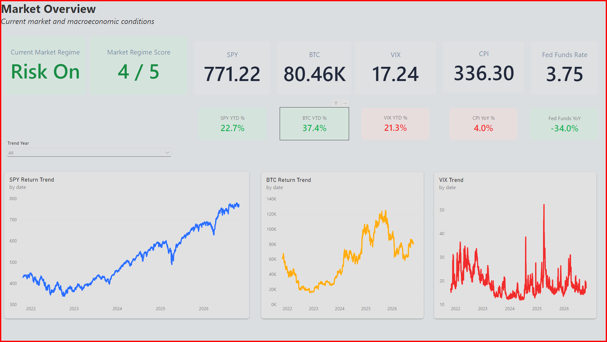
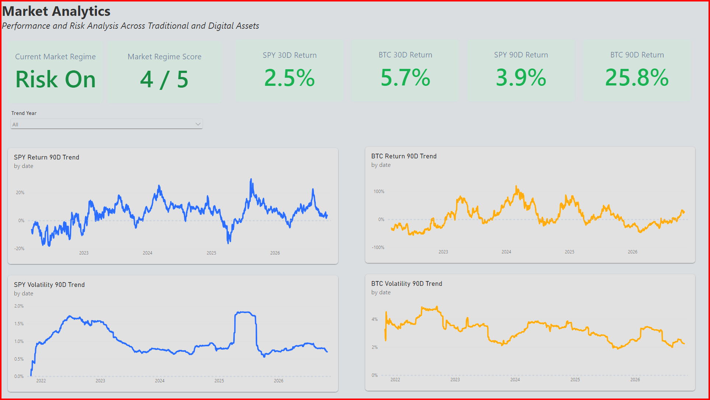
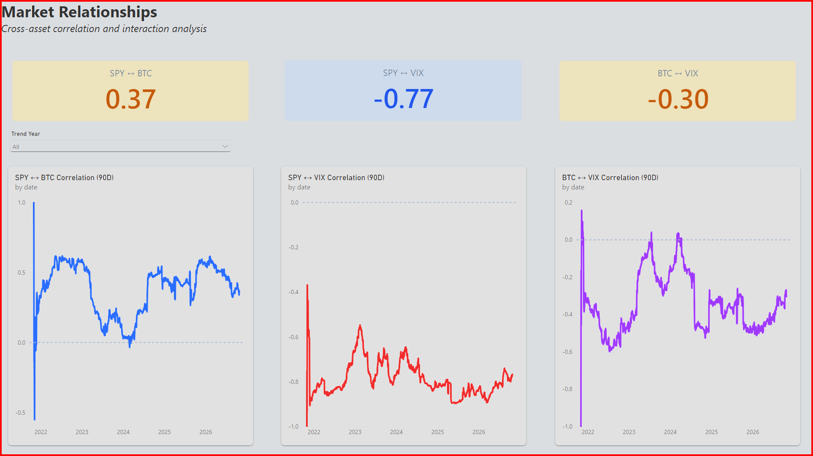
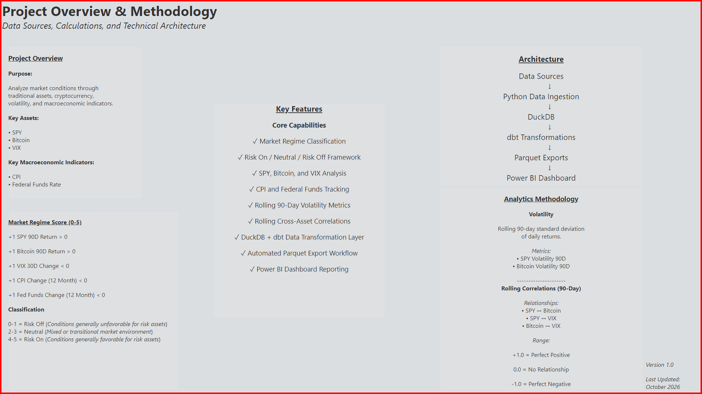

# Market Regime Analytics Platform

An end-to-end analytics engineering project built with Python, DuckDB, dbt, Parquet, and Power BI.

## Project Overview

This project analyzes market conditions using traditional assets, cryptocurrency, volatility metrics, and macroeconomic indicators.

The dashboard combines market performance, risk metrics, macroeconomic trends, and cross-asset relationships to classify market environments as **Risk On**, **Neutral**, or **Risk Off**.

## Technical Architecture

```text
Data Sources
      ↓
Python Data Ingestion
      ↓
DuckDB
      ↓
dbt Transformations
      ↓
Parquet Exports
      ↓
Power BI Dashboard
```

## Technology Stack

- Python
- DuckDB
- dbt
- Power BI
- Parquet
- Git
- GitHub

## Key Features

- Market Regime Classification
- 5-Factor Market Regime Score
- Rolling 90-Day Returns
- Rolling 90-Day Volatility
- Rolling Cross-Asset Correlations
- CPI & Federal Funds Monitoring
- Automated Parquet Export Workflow
- Interactive Power BI Dashboard Reporting

## Market Regime Methodology

Each positive signal contributes **+1 point** toward the Market Regime Score.

### Signals

- SPY 90-Day Return > 0
- Bitcoin 90-Day Return > 0
- VIX 30-Day Change < 0
- CPI Change (12 Month) < 0
- Fed Funds Change (12 Month) < 0

### Classification

| Score | Regime |
|--------|--------|
| 0-1 | Risk Off |
| 2-3 | Neutral |
| 4-5 | Risk On |

# Dashboard Pages

## Market Overview

Current market and macroeconomic conditions.



## Market Analytics

Returns, volatility, and market regime analysis.



## Market Relationships

Cross-asset correlation and interaction analysis.



## Project Overview & Methodology

Project architecture, calculations, and methodology.



## Future Enhancements

- YTD / 1Y / 3Y / 5Y period selector
- Additional macroeconomic indicators
- Automated refresh scheduling
- Enhanced market regime modeling
- Cloud deployment

## Lessons Learned

This project provided hands-on experience with:

- Analytics Engineering
- Dimensional Modeling
- dbt
- DuckDB
- Financial Analytics
- Power BI Dashboard Design
- Git & GitHub Workflows
- Parquet-Based Reporting Architecture